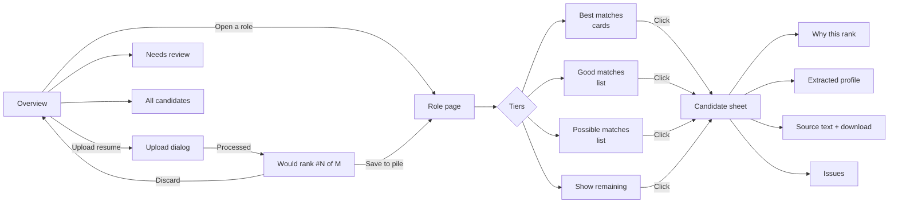
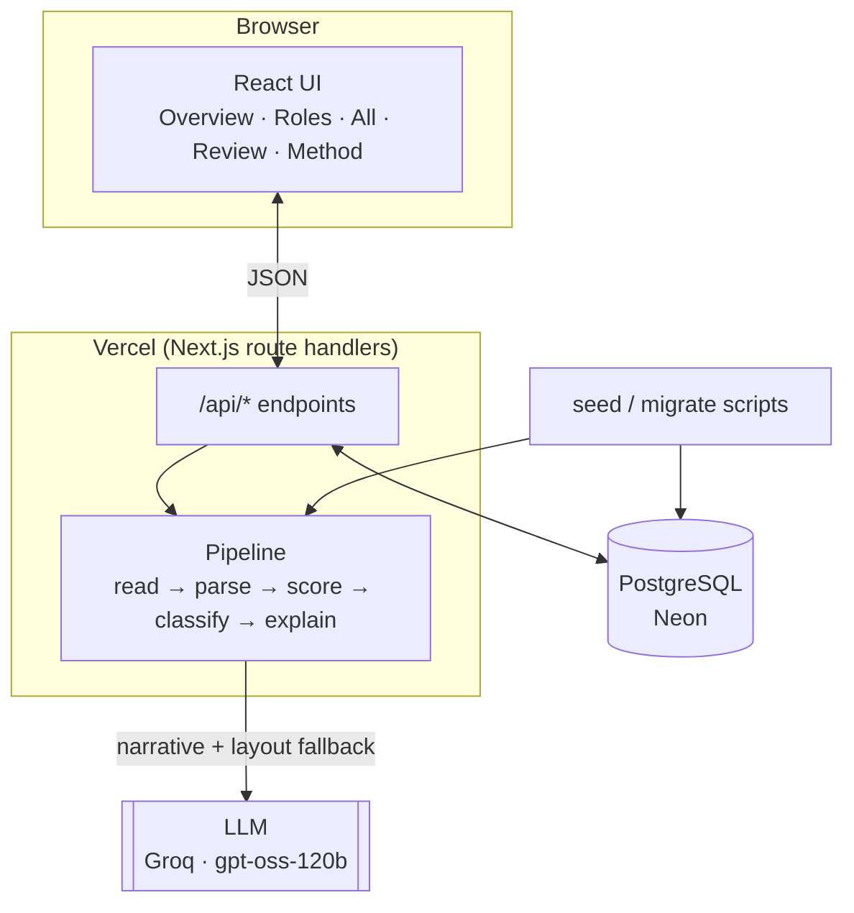
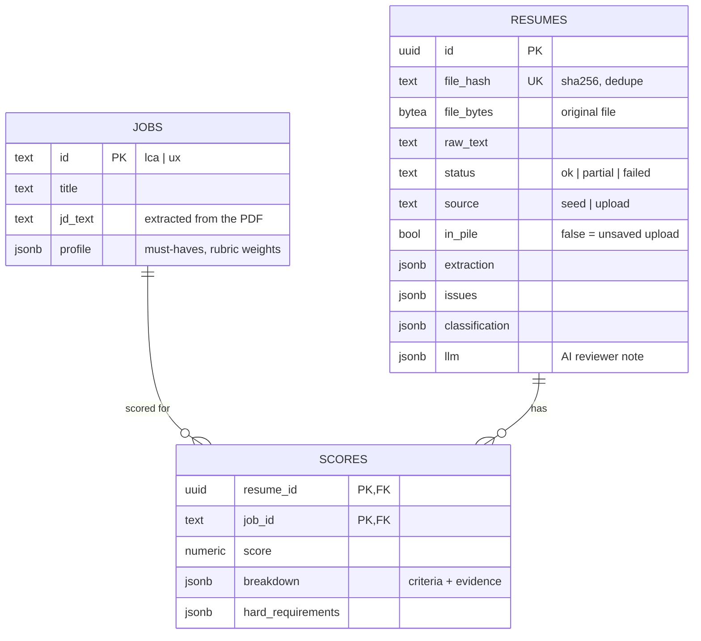

# Talent Lens

**Resume screening prototype for Growth For Impact.** Talent Lens reads a pile of resumes, pulls out the job-relevant facts, scores every resume against two job descriptions, classifies it, and ranks candidates per role. Every point of every score links back to a quoted line of the resume, so an HR reviewer can see *why* someone ranks where they do.

| | |
|---|---|
| **Live prototype** | https://talent-lens-omega.vercel.app |
| **Roles screened** | JD1 · LCA Consultant (Chennai, onsite) and JD2 · UI/UX Design Intern (remote) |
| **Resumes** | 47 anonymised `.docx` files, plus any resume uploaded through the UI |
| **Stack** | Next.js 16 · TypeScript · PostgreSQL (Neon) · Groq / Ollama · Vercel |

---

## Contents

1. [The problem](#1-the-problem)
2. [What the prototype does](#2-what-the-prototype-does)
3. [User flow](#3-user-flow)
4. [Architecture](#4-architecture)
5. [Tech stack and why](#5-tech-stack-and-why)
6. [Key decisions](#6-key-decisions)
7. [Processing pipeline](#7-processing-pipeline)
8. [Scoring and ranking method](#8-scoring-and-ranking-method)
9. [Error handling](#9-error-handling)
10. [API reference](#10-api-reference)
11. [Data model](#11-data-model)
12. [Project structure](#12-project-structure)
13. [Running locally](#13-running-locally)
14. [Deploying](#14-deploying)
15. [Results on the supplied pile](#15-results-on-the-supplied-pile)
16. [Limitations and next steps](#16-limitations-and-next-steps)

---

## 1. The problem

A company posted two very different openings and received one mixed pile of 47 resumes:

- **JD1 – LCA Consultant.** Build Life Cycle Inventory datasets and run ISO 14040/14044 LCA studies in GaBi or SimaPro. Needs 2–3 years running LCA projects independently and at least 3 completed LCA projects. Onsite in Chennai.
- **JD2 – UI/UX Design Intern.** Redesign the website and job board in Figma. Needs 0–1 year of experience, user research and an understanding of user psychology. Remote.

The HR team is not technical. They need a hosted tool that can:

- sort the pile by role,
- explain each ranking in plain language,
- surface problems with the files instead of hiding them,
- rank a new resume against the existing pile when one is uploaded.

## 2. What the prototype does

| Requirement | How it is met |
|---|---|
| Ingest resumes and JDs | `npm run seed` reads both JD PDFs and every resume into Postgres. Original file bytes are kept. |
| Extract job-related information | A rule-based parser extracts experience with dates, projects, education, skills, certifications and languages. An LLM structures layouts the rules don't recognise. |
| Classify per role | Each resume gets **LCA**, **UI/UX**, **Both**, **Uncertain** or **Neither**, plus a confidence level and a one-line reason. |
| Rank separately per role | Two independent 100-point scores. Each role page groups candidates into Best, Good and Possible matches. |
| Explain each ranking | Per-criterion points with quoted evidence, pass/fail must-have checks, and an AI reviewer note. |
| Link to the source | Original-file download plus a searchable view of the extracted text. |
| Filtering and sorting | Search on every page. Filter by classification and minimum score. Sort by best, LCA or UI/UX score, experience, name or issues. |
| Show errors clearly | Each resume has an Issues tab, and a **Needs review** page groups problems by type. |
| Test with a new resume | **Upload resume** runs the same pipeline, shows where the file would rank, then lets you save it to the pile or discard it. |

## 3. User flow



1. **Overview.** The reviewer sees three headline numbers: resumes screened, LCA matches and UI/UX matches. Below them is one card per role with a match-strength bar and the top 3 candidates.
2. **Role page.** Candidates are grouped by match strength:
   - **Best matches (70+)** as comparable cards,
   - **Good matches (50–69)** and **Possible matches (28–49)** as compact lists,
   - a **Show remaining** button for everyone else.

   **Job details & rubric** shows the JD summary and exactly how each criterion is scored.
3. **Candidate sheet.** This opens from any list and has four tabs:
   - **Why this rank:** score, rank, must-have checks, per-criterion bars with quoted evidence, and the AI reviewer note. It can switch between the two roles.
   - **Extracted profile:** experience timeline, projects, education, skills and certifications.
   - **Source text:** the exact extracted text, a highlight-search box and a download of the original file.
   - **Issues:** every problem found while processing, with its stage and its effect on the score.
4. **Upload resume.** Drop in a `.docx`, `.pdf` or `.txt` file. The dialog shows progress, then both scores and the rank the file would take for each role. It stays *unsaved* until the reviewer clicks **Save to pile**; **Discard** deletes it.
5. **Needs review.** Lists uncertain classifications and files with extraction problems (unreadable, damaged text, missing dates, very short), grouped by type.
6. **All candidates.** A single list with both scores side by side, for comparing across roles.
7. **Scoring method.** The pipeline, classification thresholds, tiers and both rubrics, written for a non-technical reader.

## 4. Architecture



- **One codebase, one deploy.** The UI and the API are the same Next.js app on Vercel's free tier.
- **The same pipeline everywhere.** `src/lib/pipeline.ts` is used both by the seed script for the bulk pile and by `/api/upload` for single uploads. An uploaded resume is therefore scored exactly the way the pile was.
- **Stateless functions.** All state lives in Postgres, including the original files.

## 5. Tech stack and why

| Layer | Choice | Why |
|---|---|---|
| Framework | **Next.js 16 (App Router), TypeScript** | UI and API in one project, deploys to Vercel's free tier with no configuration, and is strongly typed from the parser through to the UI. |
| Database | **PostgreSQL**: local Postgres in development, **Neon** in production | Relational data (resumes ↔ scores) with `jsonb` for flexible extraction output. Neon is free, serverless and works from Vercel functions. |
| DB driver | `pg` | Small and dependable. Works against both local Postgres and Neon by changing only the connection string. |
| LLM | Any **OpenAI-compatible** endpoint: **Ollama `llama3.1:8b`** locally, **Groq `openai/gpt-oss-120b`** in production | One thin client, and switching providers is an env change. Ollama keeps development free and offline; Groq is fast (~2 s per resume) and free for the hosted demo. |
| File parsing | `mammoth` (.docx), `unpdf` (.pdf) | Pure JavaScript, so it runs inside Vercel functions without native binaries. |
| UI | React 19, Tailwind CSS v4, `lucide-react` icons, **Google Sans Flex** | Apple-style layout: sidebar, large titles, grouped lists. Liquid glass is used only on buttons and the Overview stat tiles. Light and dark mode. |
| Hosting | **Vercel** | Free, HTTPS, a shareable URL for a non-technical audience. |

## 6. Key decisions

| Decision | Alternatives considered | Why we chose it |
|---|---|---|
| **Deterministic rubric for scores; the LLM only explains** | Ask an LLM to score each resume | HR needs rankings that are reproducible and auditable. A rubric gives the same score every time, ties each point to evidence, and keeps working when the LLM is down or rate-limited. |
| **Rules-first parsing with an LLM fallback** | LLM-only extraction | The supplied resumes share a template, which rules parse reliably, fast and free. The LLM is called only when the layout isn't recognised, so unfamiliar uploads still work. |
| **Two independent scores, then classify** | One multi-class classifier | Independent scores make **Both** and **Neither** natural outcomes and let each role be ranked on its own. |
| **Used the JD's 2–3 years for the LCA role** | The problem statement's 4–6 years | The two sources conflict. The JD is the source of truth candidates applied to, so we used it. Candidates above 3.5 years are not penalised but get a note ("may be senior for the role"). The band is defined in `src/lib/scoring/lca.ts` and `src/lib/jobs.ts`. |
| **Overlap-aware experience in months** | Sum each role's duration | Several resumes list concurrent roles. Counting the best-weighted role per month avoids double counting. |
| **Weighted relevance of experience** | Count all experience equally | A year of ESG reporting is not a year of LCA. Core LCA roles count 100%, adjacent sustainability roles 25%, and internships or academic roles half. |
| **Detect anonymisation damage** | Ignore it | The anonymiser stripped digits ("ISO /s" instead of "ISO 14040/44"). Such cases get partial credit for the standard and a visible warning rather than a silent zero. |
| **Store original files in Postgres (`bytea`)** | Object storage (S3 or Vercel Blob) | Resumes are ~10 KB. One store is simpler, and every result always links back to its source. |
| **Uploads start unsaved** | Insert straight into the pile | Testing must not pollute the pile. The reviewer chooses **Save to pile** or **Discard**; unsaved uploads are purged after 24 h. |
| **Deduplicate by SHA-256 of the file** | None | Re-uploading the same file returns the existing result instead of creating a duplicate. |
| **Match tiers (70 / 50 / 28)** | One long ranked list | Reviewers asked to see the best matches first, then mediocre ones, and everything else only on demand. |
| **No authentication** | Login | The audience is a reviewer testing a prototype, and every resume is anonymised. Authentication is listed as a next step. |

## 7. Processing pipeline

`src/lib/pipeline.ts → processResume(filename, buffer)`

| Step | Module | What happens |
|---|---|---|
| **1. Read** | `extract/read.ts` | Detects the type from the file's leading bytes and extension. Converts .docx, .pdf and .txt to text and normalises whitespace. Empty files, scanned PDFs, legacy `.doc` and corrupt files become *errors*, not crashes. |
| **2. Parse** | `extract/parse.ts` | Finds sections from heading synonyms (Experience, Projects, Education, Skills…). Role headers become `role · org · date range` in any of several formats. Dates are normalised (`Jul 2025 – Present`, `11/2025 – 01/2026`, `Sep '25`, `8 Months`, `(Jan 2023 to Present)`). Roles are tagged job, internship, academic or freelance. Education gets a level (school, bachelor's, master's…) and grade. |
| **3. Quality checks** | `extract/parse.ts` | Flags missing or unparsable dates, future end dates, odd education years, very short resumes, a missing experience section, and anonymiser damage. |
| **4. LLM fallback** | `llm.ts → structureResume` | Runs only when the rules find almost no structure. The LLM returns the same schema, and the result is marked *LLM-structured*. |
| **5. Score** | `scoring/lca.ts`, `scoring/ux.ts` | Two 100-point rubrics. Each criterion returns points, a one-line explanation and quoted evidence (section, label, snippet, and whether the term was applied or only listed). |
| **6. Classify** | `scoring/classify.ts` | Thresholds on the two scores produce a label, a lean, a confidence and a reason. |
| **7. Explain** | `llm.ts → narrate` | The LLM writes a headline, summary, per-role take, strengths and concerns, using only the extracted data and the already-computed requirement outcomes. Rate limits are retried. Failures are recorded as an *info* issue and never affect the score. |
| **8. Persist** | `repo.ts` | Writes the resume and both score rows in one transaction, keyed by file hash. |

## 8. Scoring and ranking method

### 8.1 LCA Consultant (JD1) — 100 points

| Criterion | Pts | Rule |
|---|---:|---|
| Relevant LCA experience | 25 | Weighted years. Roles whose text shows LCA work count 100%, adjacent sustainability/GHG roles 25%, internships/academic ×0.5. **≥ 2 years = full marks**; 1–2 years scales 50–100%; below 1 year scales 0–50%. |
| GaBi / SimaPro | 20 | Used in experience/projects **20** · listed in skills only **15** · other LCA tool only (openLCA, Air.e, EIME…) **8** |
| Completed LCA projects | 15 | Distinct LCA studies/EPDs evidenced: **≥3 → 15**, 2 → 10, 1 → 5 |
| Methodology depth | 15 | LCI, system boundaries, functional unit, cradle-to-gate/grave, ecoinvent, impact methods, hotspots, allocation, data validation, benchmarking… **2.5 applied / 1 listed**, max 15 |
| ISO 14040/14044 | 10 | Explicit **10** · ISO reference in LCA context with digits stripped **7** · related standards (ISO 14067, EN 15804, PCR, GHG Protocol) **5** |
| Education | 10 | Environmental/sustainability degree **10** · engineering/science **6** · other **3** |
| EPD (preferred) | 5 | Applied **5** · mentioned **3** |

**Must-have checks** (shown as Met / Partly met / Not met / Unknown): 2–3 years running LCA projects · GaBi or SimaPro · ≥ 3 LCA projects · ISO 14040/14044 · Chennai onsite. The last is usually *Unknown*, because the resumes don't state a location.

### 8.2 UI/UX Design Intern (JD2) — 100 points

| Criterion | Pts | Rule |
|---|---:|---|
| Figma & prototyping | 20 | Figma used in work **14** / listed **10**, plus prototyping evidence **6** (listed only 4) |
| User research & psychology | 20 | Interviews, usability testing, personas, journey maps, heuristic evaluation, card sorting, A/B tests, behavioural UX… **4 applied / 2 listed**, max 20 |
| Portfolio & projects | 15 | Design projects + design roles: 1 → 6 · 2 → 9 · 3 → 12 · **4+ → 15** |
| UI craft & visual design | 15 | Visual hierarchy, typography, design systems, responsive design, accessibility/WCAG, micro-interactions… **2.5 applied / 1.5 listed** |
| Experience fit (0–1 yr) | 15 | ≤ 1.5 yrs **15** · no experience but 2+ projects **9** · 1.5–3 yrs **11** · > 3 yrs **7** (likely over-qualified) |
| Education | 10 | Design/HCI **10** · CS/IT/engineering **6** · other **4** · **+2** for a UX certificate |
| Website / job-board relevance | 5 | Websites, hiring/job platforms, dashboards/SaaS, sustainability — 1.5 each |

**Must-have checks:** Figma & prototyping · user psychology/research (≥ 2 applied methods) · design portfolio (≥ 2 pieces) · 0–1 year experience band.

### 8.3 Classification

| Label | Rule |
|---|---|
| **Both roles** | LCA ≥ 50 **and** UI/UX ≥ 50 |
| **LCA match** / **UI/UX match** | That role ≥ 50, the other below |
| **Uncertain** (leans LCA or UI/UX) | Best score 28–49 — a partial fit that needs a human |
| **Neither** | Both scores < 28 |
| **Unreadable** | File could not be read; nothing to score |

**Confidence** is *high* by default. It drops to *medium* when the best score is within 6 points of the bar, the two scores are within 15 points of each other, or the text was damaged. It drops to *low* for uncertain results on damaged text.

### 8.4 Ranking and tiers

- **Rank** = position in the pile by that role's score, highest first (ties share a rank). An unsaved upload is ranked as if it had been inserted.
- **Tiers** used on role pages: **Best matches 70–100**, **Good 50–69**, **Possible 28–49**, **Low fit 0–27**.

## 9. Error handling

Problems are recorded as *issues* on the resume. Each issue has a stage, a severity and a plain-English message, shown in the candidate's **Issues** tab and on the **Needs review** page.

| Code | Severity | Meaning | Effect |
|---|---|---|---|
| `EMPTY_DOCUMENT` | error | File opened but contains no text (or a scanned PDF with no text layer) | Marked *Unreadable*; kept with a download link |
| `READ_FAILED` | error | File corrupt or password-protected | Same as above |
| `UNSUPPORTED_DOC` / `UNSUPPORTED_TYPE` | error | Legacy `.doc` or unknown format | Same as above, with instructions to re-save as .docx/.pdf |
| `REDACTION_DAMAGE` | warning | Anonymiser stripped digits or words ("ISO /s", "Scope s") | Partial credit for standards; lower confidence |
| `DATE_UNPARSED` | warning | A role has missing or unreadable dates | That role is excluded from experience totals |
| `DATE_FUTURE` | warning | End date in the future (e.g. "Dec 2026") | Treated as ongoing up to today |
| `SPARSE` | warning | Fewer than 80 words | Score relies on little evidence |
| `LAYOUT_UNRECOGNISED` / `LLM_STRUCTURE_FAILED` | warning | Layout not recognised and LLM unavailable | Scored from keywords only |
| `DATE_APPROX`, `EDU_DATE_ODD`, `NO_EXPERIENCE` | info | Year-only dates, odd education years, no experience section | Noted for the reviewer |
| `LLM_STRUCTURED` | info | Sections were structured by the LLM | Verify against the source |
| `LLM_UNAVAILABLE` | info | AI note couldn't be generated (timeout or rate limit) | Score unaffected |

Resume status is `ok`, `partial` (has warnings) or `failed` (has errors).

## 10. API reference

All endpoints are Next.js route handlers under `/api` and return JSON unless noted.

| Method | Endpoint | Purpose |
|---|---|---|
| `GET` | `/api/health` | Database and LLM status |
| `GET` | `/api/jobs` | Both job profiles (JD text, must-haves, rubric) |
| `GET` | `/api/candidates` | Every resume in the pile with scores, classification, extraction, issues and AI note |
| `GET` | `/api/candidates/:id` | One resume, including the full extracted `raw_text` |
| `PATCH` | `/api/candidates/:id` | Save an upload to the pile (or remove one from it) |
| `DELETE` | `/api/candidates/:id` | Discard an **unsaved upload** |
| `GET` | `/api/candidates/:id/file` | Download the original resume file |
| `POST` | `/api/upload` | Upload and process a new resume |

<details>
<summary><b>Request and response details</b></summary>

**`GET /api/health`**
```json
{ "db": "ok", "llm": { "provider": "Groq", "model": "openai/gpt-oss-120b" } }
```
`llm` is `null` when the LLM is disabled (rules-only mode).

**`GET /api/candidates?include=<id>`**
Returns `{ "candidates": Candidate[] }` for every resume in the pile. `include` adds one unsaved upload so it can be ranked in context.
```jsonc
{
  "id": "uuid", "filename": "anonymized_HM_1793682784257.docx", "candidate_code": "HM",
  "status": "ok | partial | failed", "source": "seed | upload", "in_pile": true,
  "classification": { "label": "lca", "lean": "lca", "confidence": "medium", "reason": "…" },
  "scores": {
    "lca": { "score": 88, "breakdown": { "criteria": [/* points, weight, detail, evidence[] */], "facts": {}, "notes": [] },
             "hard": [{ "key": "software", "label": "GaBi or SimaPro", "status": "partial", "detail": "Listed in skills only" }] },
    "ux":  { "score": 22, "breakdown": { }, "hard": [] }
  },
  "extraction": { "experience": [], "projects": [], "education": [], "skills": {}, "summary": "…" },
  "issues": [{ "stage": "extract", "severity": "warning", "code": "REDACTION_DAMAGE", "message": "…" }],
  "llm": { "headline": "…", "summary": "…", "lca_take": "…", "ux_take": "…", "strengths": [], "concerns": [], "model": "…" }
}
```

**`PATCH /api/candidates/:id`** — body `{ "in_pile": true }` → `{ "ok": true }`. Returns `400` for a bad body and `404` if the resume doesn't exist.

**`DELETE /api/candidates/:id`** → `{ "ok": true }`. Returns `409` if the resume is a seeded or saved one (only unsaved uploads can be discarded).

**`GET /api/candidates/:id/file`** — the original bytes with `Content-Disposition: attachment`.

**`POST /api/upload`** — `multipart/form-data` with field `file` (`.docx`, `.pdf` or `.txt`, ≤ 5 MB, up to 60 s processing).
```json
{ "candidate": { "…": "same shape as above, in_pile: false" }, "duplicate": false, "alreadyInPile": false }
```
Errors: `400` no file or empty file · `413` larger than 5 MB · `500` processing failure. An unreadable file is **not** an HTTP error: it returns `200` with `status: "failed"` and the issue explained.
</details>

## 11. Data model

`db/schema.sql`



## 12. Project structure

```
talent-lens/
├── db/schema.sql               Postgres schema (jobs, resumes, scores)
├── scripts/
│   ├── migrate.ts              apply the schema
│   └── seed.ts                 ingest JDs + resume folder through the pipeline
└── src/
    ├── lib/
    │   ├── extract/
    │   │   ├── read.ts         file → text (docx / pdf / txt) + read errors
    │   │   ├── parse.ts        sections, roles, dates, education, skills, quality checks
    │   │   └── dates.ts        date-range parsing, overlap-aware month counting
    │   ├── scoring/
    │   │   ├── lca.ts          JD1 rubric + must-haves
    │   │   ├── ux.ts           JD2 rubric + must-haves
    │   │   ├── classify.ts     thresholds → label, lean, confidence
    │   │   └── evidence.ts     searchable resume units + quoted evidence
    │   ├── jobs.ts             job profiles shown in the UI
    │   ├── llm.ts              OpenAI-compatible client: narrative + layout fallback
    │   ├── pipeline.ts         end-to-end processing of one file
    │   ├── repo.ts             database queries
    │   └── db.ts               connection pool (local / Neon)
    ├── app/
    │   ├── api/…               route handlers (see API reference)
    │   ├── layout.tsx          fonts, theme bootstrapping
    │   └── globals.css         design tokens, glass controls, light/dark themes
    └── components/
        ├── App.tsx             shell: sidebar, toolbar, routing, upload/save/discard
        ├── views.tsx           Overview, Role, All, Needs review, Scoring method pages
        ├── rows.tsx            candidate card + list row
        ├── Detail.tsx          candidate sheet (why / profile / source / issues)
        ├── Upload.tsx          upload dialog and result
        ├── JobPanel.tsx        job details & rubric
        ├── ui.tsx              score ring, pills, must-have badges
        └── model.ts            client types, tiers, ranking helpers
```

## 13. Running locally

**Prerequisites:** Node 20+, PostgreSQL 13+, and optionally [Ollama](https://ollama.com) with `ollama pull llama3.1:8b`.

```bash
cd talent-lens
cp .env.example .env.local        # set DATABASE_URL and LLM_* (Ollama by default)
createdb talent_lens
npm install
npm run db:migrate                # create tables
npm run seed                      # ingest ../JD1.pdf, ../JD2.pdf and ../Software Development Assignment Resumes
npm run dev                       # http://localhost:3000
```

**Seed options**

| Flag | Effect |
|---|---|
| `--no-llm` | Rules only (takes seconds). AI notes already stored are kept. |
| `--dir <folder>` | Resume folder (default `../Software Development Assignment Resumes`) |
| `--jd-dir <folder>` | Folder containing `JD1.pdf` and `JD2.pdf` (default `..`) |
| `--concurrency <n>` | Parallel workers (default 1 for Ollama, 2 otherwise) |

Re-running the seed is safe: resumes are keyed by file hash.

**Environment variables**

| Variable | Example | Notes |
|---|---|---|
| `DATABASE_URL` | `postgres://localhost:5432/talent_lens` | Neon URLs get verified TLS automatically |
| `LLM_BASE_URL` | `http://localhost:11434/v1` · `https://api.groq.com/openai/v1` | Any OpenAI-compatible endpoint |
| `LLM_MODEL` | `llama3.1:8b` · `openai/gpt-oss-120b` | |
| `LLM_API_KEY` | `ollama` · `gsk_…` | |
| `LLM_ENABLED` | `on` / `off` | `off` = rules-only mode |

## 14. Deploying

1. **Database.** Create a free Neon Postgres database and copy its connection string.
2. **LLM.** Create a free Groq API key.
3. **Seed production** from your machine:
   ```bash
   DATABASE_URL="postgres://…neon…" npm run db:migrate
   DATABASE_URL="postgres://…neon…" LLM_BASE_URL=https://api.groq.com/openai/v1 \
   LLM_MODEL=openai/gpt-oss-120b LLM_API_KEY=gsk_… npm run seed -- --concurrency 1
   ```
4. **Deploy:** `vercel link`, add the five environment variables (`vercel env add …`), then `vercel --prod`.

## 15. Results on the supplied pile

| | Count |
|---|---:|
| Resumes ingested | 47 |
| LCA matches | 10 (7 best matches) |
| UI/UX matches | 23 (12 best matches) |
| Uncertain | 4 |
| Neither | 9 |
| Unreadable | 1 (`anonymized_resume_1793685080327.docx` contains no text) |

**Top 3 for each role:** LCA: HM 88 · TM 81 · SS 80. UI/UX: AY 96 · CG 95 · DVJ 94.

**Spot checks behind these numbers:**
- LCA leaders have years of LCA work in SimaPro or GaBi and published EPDs.
- Applicants with ESG reporting but no LCA projects land in *Uncertain* or *Neither*.
- Experienced product designers (e.g. 3+ years running a design consultancy) are flagged as likely over-qualified for the internship.
- No LCA candidate meets *every* must-have. The location is never stated, and most resumes lost the digits of "ISO 14040/44" to anonymisation.

## 16. Limitations and next steps

- **Keyword-based evidence.** The rubrics use curated term lists. Synonyms outside them are missed. Next step: embedding similarity as an extra, explainable signal.
- **Anonymisation damage.** It is detected and shown, but not repaired. Scoring the original text would remove the issue.
- **Location and availability** aren't in the resumes, so they are shown as *Unknown* rather than guessed.
- **No authentication or audit log.** Add login and record reviewer decisions (shortlist / reject / notes) before real use.
- **No OCR.** Scanned PDFs are flagged as unreadable rather than processed.
- **LLM rate limits.** On Groq's free tier, a burst of uploads can miss the AI note (the score is unaffected). The fix is a paid tier or a queue.
- **Tests.** Parser and rubric behaviour was validated against all 47 resumes plus non-template uploads. A unit-test suite would lock this in.
